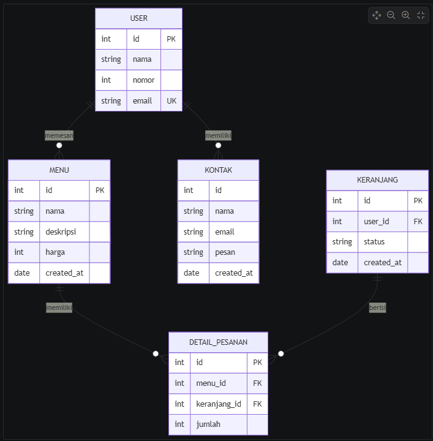
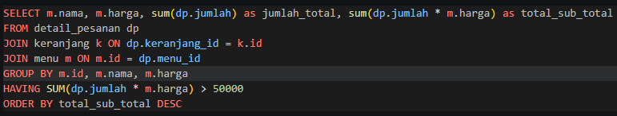
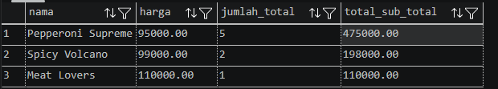

# KairnPizza
- users untuk menyimpan data user
- menu - meyimpan data menu
- keranjang = meyimpan data keranjang
- detail_pemesanan - menyimpan data pemesanan
- kontak - menyimpan data kontak

## ERD

## Query

## Result
